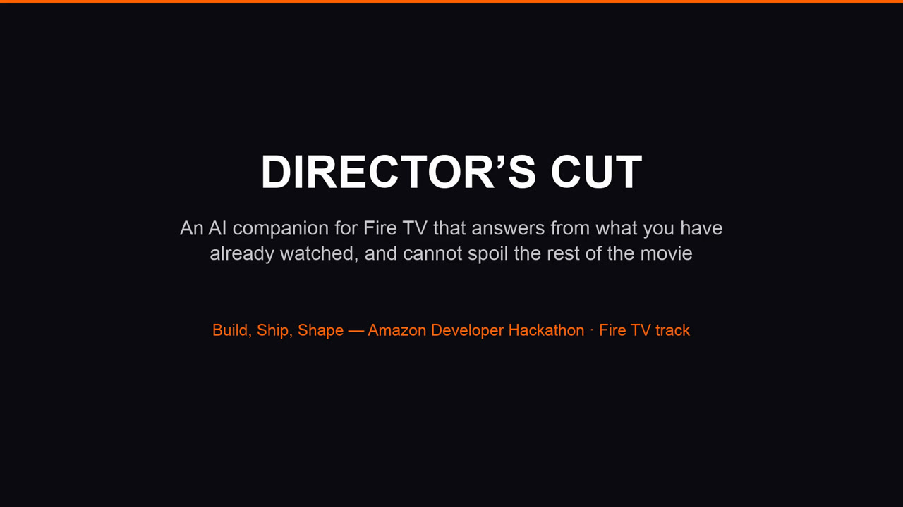
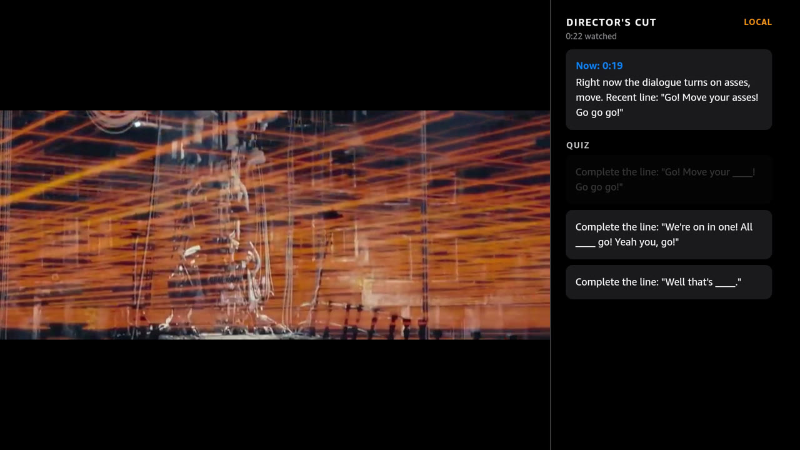
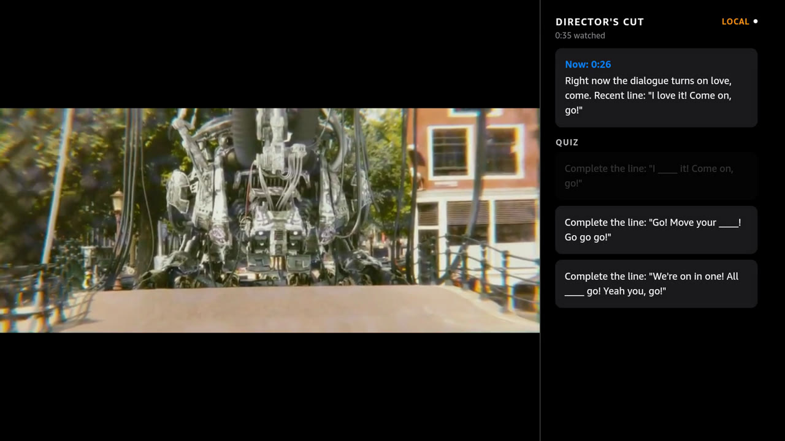
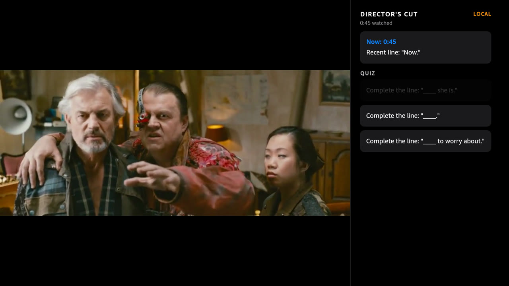

# Director's Cut 🎬 trivia-party

**AI watch-party trivia companion for Fire TV (Vega OS).**
Watch a movie with a panel of AI movie-critic friends: Director's Cut streams **Big Buck Bunny** with perfectly synced captions, generates live trivia from the film's own dialogue/captions using a [Strands Agents](https://github.com/strands-agents) powered engine, and lets three critic bots (Rascal, Frank, Gimera) race to answer while you keep score from the couch.

Built for the **Fire TV Vega hackathon** — developed entirely against the **Vega Virtual Device (VVD)**.



---

## How it works

```
┌──────────────────────────────┐        range-fetch fMP4 chunks         ┌─────────────────────────┐
│  Fire TV app (RN 0.72 Vega)  │ ◀────────── http://10.0.2.2:8788 ───── │   AI engine (Fastify)   │
│                              │                                        │                         │
│  ┌────────┐  ┌────────────┐  │   POST /trivia {cues, playhead}        │  Strands Agent          │
│  │ Video  │  │   right    │  │ ─────────────────────────────────────▶ │   - MockModel (default) │
│  │ (MSE)  │  │ captions ↑ │  │   ◀── 1 question + 4 options ───────── │   - BedrockModel (opt)  │
│  │        │  │   trivia ↓ │  │                                        │                         │
│  └────────┘  └────────────┘  │   GET /captions (SRT, parsed client)   │  GET /media/*.mp4/.srt  │
│  [ Rascal ][ Frank ][ Gim..] │                                        │  (Byte-range capable)   │
└──────────────────────────────┘                                        └─────────────────────────┘
```

- **Video**: streamed as fragmented MP4 over **MSE (MediaSource Extensions)** — `MediaSource` + `SourceBuffer.appendBuffer`, fed by ordinary JS `fetch` of range-chunked fMP4 (1.2 MB chunks, starts playing at ~25 % buffered). The blob URL must carry a query suffix (`blob:///${id}?offset=0`) — see FRICTION_LOG entry #20.
- **Captions**: the engine serves the film's SRT; the app parses it, syncs cues to `currentTime`, and shows a caption ticker in the right column.
- **Trivia**: every few caption cues the app posts recent cues + playhead to the engine; a Strands Agent answers with one 4-option question (deterministic MockModel by default, so demos are reproducible; swap in Bedrock with `STRANDS_BEDROCK=1`).
- **Critic bots**: three local bots answer with different skill instincts and race on a bottom scoreboard.
- **TV remote support**: D-pad ⇆ focus between trivia options, Select to answer, Play/Pause via the media-playback keys.

## Why MSE instead of a plain video URL?

Vega OS blocks cleartext `http://` **for the native media pipeline** (MPB) — and `file://` on the VVD as well — returning a bare `MEDIA_ERR_SRC_NOT_SUPPORTED` with an empty message. Ordinary app-JS `fetch` is *not* subject to that policy, which keeps the MSE path open. This platform behavior is fully chronicled (with evidence) in [`FRICTION_LOG.md`](FRICTION_LOG.md) entries #18–#20.

> **Branches**: `main` is this RN 0.72 + MSE app (the hackathon submission). The `monorepo` branch contains the earlier monorepo codebase of the same project (Vega TypeScript app, agent + docs included) — kept for history.

## See it running

Stills from the demo reel — the AI panel turns the film's own lines into a live quiz while you watch:

| | |
| :---: | :---: |
|  |  |
| *Question built from the film's recent line, in-flight* | *One answered (dimmed); the queue refreshes behind the playhead* |
|  | |
| *Fresh quiz set right after the playhead moves on — no spoilers from what you haven't watched* | |

## Repo layout
```
directorscut72/
├── src/               # RN 0.72 Vega app (TypeScript)
│   ├── screens/WatchPartyScreen.tsx   # the whole show: video pane, captions, trivia, bots, HUD
│   ├── lib/mse-player.ts             # MSE pipeline: blob URL (?offset=0), ranged fetch+append, early play
│   ├── lib/captions.ts               # SRT → timed cues
│   ├── lib/ai.ts                     # engine client (trivia + captions)
│   ├── lib/local-trivia.ts           # offline fallback questions
│   └── assets/                       # template art we customized
├── engine/            # Fastify + Strands Agent trivia engine (:8788)
│   └── src/
│       ├── server.ts        # /health /trivia /captions /media (byte ranges)
│       ├── trivia-engine.ts # cue → question generation via Strands Agent
│       └── mock-model.ts    # deterministic MockModel (zero-cost demo mode)
├── manifest.toml      # Vega package manifest (packageId + [wants] privileges)
├── start-engine.sh    # ⚡ one command → engine on :8788 (demo mode, no keys)
├── run-app.sh         # ⚡ one command → build-if-needed + deploy to the VVD
├── FRICTION_LOG.md    # 22 entries documenting every wall we hit + suggested fixes
├── babel.config.js    # w3cmedia-friendly JSX transform config
└── index.js           # RN root
```

## Run it — setup in minutes

> **Zero sign-up, zero API keys.** The engine ships a deterministic **demo mode**
> (Strands MockModel) that needs no accounts, no tokens, no AWS, no email. Only
> the *optional* Bedrock mode reads AWS credentials — fresh clones ignore it.
> Media + captions are **committed in the repo**, so nothing downloads and no
> encoding step is required. If the engine isn't even running, the on-device
> fallback trivia still keeps the party going.

### 0. Prerequisites (out of our control — Amazon's)
- macOS + [Vega SDK](https://amazon-vega.github.io/) (we used SDK 0.24) with the Vega Virtual Device app — only needed to run the *TV app*
- Node ≥ 18

### 1. Start the engine — one command, any machine

```bash
./start-engine.sh daemon
# → installs engine deps (first run), starts Fastify on :8788, waits for /health
#   health reports: {"ok":true,"provider":"strands-mock:deterministic","bedrockOptIn":false}
```

Serves, out of the box: the demo clip (`/media/bbb_fmp4_60s.mp4`), captions
(`/media/big-buck-bunny.srt`), trivia (`/trivia`).

### 2. Build + run the Fire TV app on the VVD — one command

```bash
./run-app.sh
# → builds the Debug .vpkg only if none exists, then deploys to the VVD
#   (equivalent: source ~/vega/env && npx react-native build-vega --build-type Debug
#              && vega run-app build/aarch64-debug/*.vpkg com.directorscut.app72.main -d VirtualDevice)
```

The app discovers the engine at `http://10.0.2.2:8788` (the VVD's host gateway) and prefers the full 10-minute movie when present; fresh clones get the committed 60-second reel, which loops.

### Want the full ~10-minute movie instead of the 60-second reel?

See [`engine/media/README.md`](engine/media/README.md) — one archive.org fetch + one ffmpeg remux (both free, no sign-up).

### 3. Use the remote
- **D-pad Down/Up**: move trivia-option focus
- **Select**: answer (correct → green reveal, bot scores update)
- **Media play/pause** key: toggle the film

## Submission notes

- [`FRICTION_LOG.md`](FRICTION_LOG.md) — every wall the tools/pipeline gave us (SDK ANRs, blocked media schemes, w3cmedia quirks, blob-URL landmines, SSE browser-day friction) and what we'd suggest Amazon fix. Bonus-track fodder written as encountered, not reconstructed. A [trag.dev](https://trag.dev/context/friction-log/)-structured companion view of the same evidence (BLUF/persona/friction-points/recommendations) lives in [`FRICTION_LOG_TRAG.md`](FRICTION_LOG_TRAG.md).
- Everything was built and demoed on the **Vega Virtual Device**, per the hackathon's VVD guidance.

## License

MIT (see [`LICENSE`](LICENSE)). Big Buck Bunny media is © Blender Foundation, CC BY 3.0; the committed 60-second demo clip and caption track carry that license (see [`engine/media/README.md`](engine/media/README.md)).
